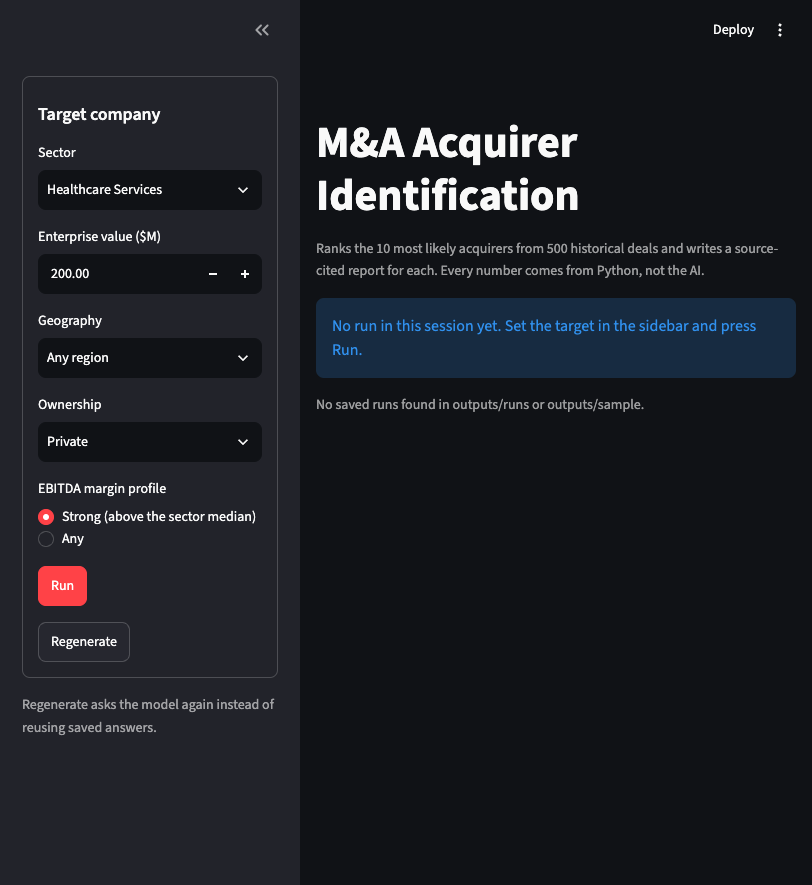
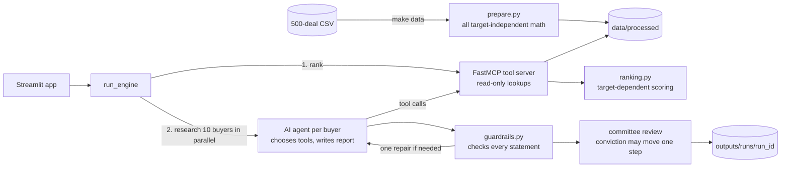

# M&A Acquirer Identification Engine

Give it a target company, for example a private Healthcare Services business worth about $200M with strong EBITDA margins. It ranks the **10 most likely buyers** from 500 historical deals and writes a **one-page, source-cited report** for each one.

Python does every calculation. An AI agent picks which data to look at and writes the reports. Every sentence is then checked against the deals it cites.



---

## Quick start

You need three things:

| What | How to get it |
|---|---|
| `uv` (installs Python 3.12 and all libraries for you) | macOS / Linux: `curl -LsSf https://astral.sh/uv/install.sh \| sh`<br>Windows (PowerShell): `powershell -ExecutionPolicy ByPass -c "irm https://astral.sh/uv/install.ps1 \| iex"` |
| `make` | Already on macOS and Linux. On Windows, use WSL, or use the commands in "Without make" below. |
| An OpenRouter API key | Create one at [openrouter.ai/keys](https://openrouter.ai/keys) |

You don't need to install Python yourself: `uv` downloads the right version.

**Steps**

```bash
git clone <this-repo-url> ma-engine
cd ma-engine
make setup                 # installs Python 3.12 and the libraries
cp .env.example .env       # then open .env and paste your key after OPENROUTER_API_KEY=
make data                  # rebuilds the pre-calculated tables (already included; safe to run)
make run                   # starts the app
```

Open the address it prints (usually http://localhost:8501). Keep the defaults and press **Run**.

**What you should see:** a progress box, while it ranks buyers and researches each of the 10 at the same time. Then a ranked table, plus one panel per buyer with four tabs:
- **Report:** the six-section report.
- **Source rows:** the original CSV rows behind every cited deal.
- **Score breakdown:** how the buyer's score was built.
- **How this was decided:** every tool the AI called, in order, with timings.

Each run is saved in `outputs/runs/<run_id>/`.

Running the same target again reuses the saved AI answers, so it is fast and free. **Regenerate** asks the AI again.

### Without make

```bash
uv sync
uv run python -m ma_engine.prepare
uv run streamlit run src/ma_engine/app.py
```

### With Docker (only Docker needed)

```bash
cp .env.example .env       # paste your key
docker build -t ma-engine .
docker run --rm -p 8501:8501 --env-file .env ma-engine
```

Open http://localhost:8501. One container runs everything:
- **The app (Streamlit):** the container's main program.
- **The data tool server (FastMCP):** started by the app, inside the container.
- **The AI model:** called over the internet at OpenRouter.

The key is passed in only when the container starts. It is never copied into the image. Stop it with `Ctrl+C` or `docker stop`.

### Without the app

```bash
uv run python -m ma_engine.engine   # one full run for the default target, printed in the terminal
make check                          # quality checks on the latest saved run
```

### No API key?

The app still opens. Pressing **Run** explains how to add the key, and you can open any saved run (from `outputs/runs/` or the example in `outputs/sample/`) without a key.

---

## Commands

| Command | What it does |
|---|---|
| `make setup` | Install Python 3.12 and the libraries (`uv sync`) |
| `make data` | Clean the raw CSV and write every pre-calculated table to `data/processed/` |
| `make run` | Start the Streamlit app |
| `make mcp` | Start only the data tool server, for other AI apps (see "Using the tools from another AI app") |
| `make test` | Run all tests (no real AI calls, no key needed) |
| `make check` | Quality checks on the latest saved run; fails if any report is not verified or fewer than 10 exist |

**Settings:** `.env` holds exactly two values:
- `OPENROUTER_API_KEY`: your key.
- `LLM_MODEL`: the model. Default `anthropic/claude-sonnet-5.5`.

Everything else is in `src/ma_engine/config.py`.

---

## Troubleshooting

| You see | Fix |
|---|---|
| `OPENROUTER_API_KEY is not set` | Run `cp .env.example .env` and paste your key into `.env`. |
| `LLM_MODEL ... is not in OpenRouter's model list` | Check the model name in `.env` (default: `anthropic/claude-sonnet-5.5`). |
| A message naming missing files in `data/processed` | Run `make data`. |
| `requires-python >=3.12` or a Python version error | Use `uv run ...` (or `make`), not your system Python. `uv` brings Python 3.12. |
| `Port 8501 is already in use` | Stop the other app, or run `uv run streamlit run src/ma_engine/app.py --server.port 8502`. |
| Rate limit or "Run stopped" message | Wait a minute and press **Run** again. Buyers already finished come from the saved answers. |
| `make: command not found` (Windows) | Use the commands under "Without make". |

---

## How it works



1. **Prepare (once).** `prepare.py` cleans the CSV. It pre-calculates buyer profiles, sector statistics and valuation tables, and gives every number a ready-to-quote label like `$185.0M` or `13.2x`.
2. **Rank (Python).** `ranking.py` scores every buyer with a relevant closed deal against the target, then picks the top 10 plus 5 reserves.
3. **Research (AI).** For each buyer, an agent calls read-only tools on a FastMCP server: buyer profile, deal history, valuation comps, deal search, sector overview. It does up to 4 rounds, then writes a structured report. It never calculates.
4. **Check (Python).** Every statement is checked against the exact tool results that agent received. A failed report gets the exact error list and one repair attempt. If it still fails, it is shown with a red **Not verified** label, never hidden.
5. **Review (AI + Python).** One committee call compares all 10 reports. It may move a conviction level up or down by one step, and each change is re-checked.

Full detail, with two diagrams and a worked example of one number traced from the CSV to the report: **[docs/architecture.md](docs/architecture.md)**.

---

## How the CSV is used

- **Source of truth:** `data/raw/ma_transactions_500.csv` is never changed. Every citation is a value from its `transaction_id` column (for example `MA-2021-0195`), so every claim can be traced back to a row. The app shows these rows.
- **What's in it:**
  - 500 deals and 107 buyers: 290 by Financial Sponsors and 210 by Strategics.
  - Outcomes: 406 Closed, 49 Withdrawn, 21 Pending, 14 Terminated, 10 Rumored.
  - Healthcare Services has 46 deals, 12 of them between $100M and $400M (10 closed).
- **Deals that didn't close** are never described as completed, and never used in valuations. A buyer's withdrawn or terminated bids are shown as weaker signals of interest.
- **Adjacent sectors:** close sectors count, so buyers with no exact-sector deal can still qualify. For Healthcare Services these are Physician Groups (closeness 0.80), Behavioral Health (0.75), Home Health/Hospice (0.75) and Dental (0.70). Closeness scores are written by hand: they are expert judgment, labelled as such everywhere, and tested for sensitivity (see "Ranking").
  - Why not learn closeness from the data? The big PE firms buy in every sector, so co-buying patterns can't tell neighbours apart.
- **Size bands** for valuation comps: under $100M, $100M–$400M, $400M–$1B, over $1B.
- **Problems found in the data, and how they're handled:**
  - The stated EBITDA margin disagrees with EBITDA ÷ revenue in 411 rows. The stated EV/EBITDA disagrees with size ÷ EBITDA in 403 rows. The engine quotes the stated columns exactly and never recomputes them.
  - `sub_sector` always equals `sector`, so it adds nothing.
  - Financial Sponsors make up 58% of deals, so the ranking makes sure both buyer types appear.

## Ranking

Each candidate gets six scores between 0 and 1, computed in Python from its **closed** deals in the target sector or adjacent sectors:

| Signal | Weight | Meaning |
|---|---|---|
| Sector fit | 0.25 | How close the buyer's deals are to the target's sector |
| Size fit | 0.20 | How close its deal sizes are to the target's $200M (log scale) |
| Repeat activity | 0.20 | How many relevant deals; an exact-sector deal counts more than an adjacent one |
| Profile fit | 0.15 | Share of deals that match: private targets, regional businesses, above-median margins |
| Recency | 0.10 | Recent deals count more (weight halves every 3 years) |
| Strategic rationale | 0.10 | Share of deals done to build a platform, gain scale, or win market share |

- **Small-sample guard:** a buyer with one perfect deal shouldn't beat one with a long good record, so each average is blended with two neutral "imaginary" deals.
- **Starting conviction:** High means a top-10% score and at least 2 deals within 2x of the target's size. Medium means an above-median score with the same deal condition. Everything else is Low. The committee review can move it one step.
- **Both buyer types:** the top 10 holds at least 3 Financial Sponsors and 3 Strategics. Strategics with real deals in the target sector are chosen first. Every buyer moved this way says so on its report.

**Default result** (before AI research; the final conviction can change by one step):

| # | Buyer | Type | Score | Starting conviction |
|---|---|---|---|---|
| 1 | Blackstone | Financial Sponsor | 0.66 | High |
| 2 | New Mountain Capital | Financial Sponsor | 0.65 | High |
| 3 | Nordic Capital | Financial Sponsor | 0.63 | High |
| 4 | Vista Equity | Financial Sponsor | 0.62 | High |
| 5 | Bain Capital | Financial Sponsor | 0.61 | High |
| 6 | Francisco Partners | Financial Sponsor | 0.60 | Medium |
| 7 | GTCR | Financial Sponsor | 0.60 | Medium |
| 8 | Atrium Health | Strategic | 0.57 | Low |
| 9 | Steward Health Care | Strategic | 0.55 | Low |
| 10 | UPMC | Strategic | 0.55 | Low |

Atrium Health, Steward and UPMC are in the list because of the buyer-type rule. Each has 3 closed Healthcare Services deals.

**How stable is this?** The weights are reasoned choices, not fitted to outcomes. So we measured what happens when they change. Run it yourself: `uv run python -m ma_engine.ranking --sensitivity`.

| Change | Names that stay in the top 10 |
|---|---|
| All weights equal | 7 of 10 |
| Drop sector fit | 7 of 10 |
| Drop size fit | 7 of 10 |
| Drop repeat activity | 4 of 10 |
| Drop profile fit | 8 of 10 |
| Drop recency | 9 of 10 |
| Drop strategic rationale | 8 of 10 |
| Looser / stricter adjacent-sector cut-off (0.5 / 0.75) | 9 / 8 of 10 |
| No small-sample guard | 7 of 10 |
| No buyer-type rule | 7 of 10 |

The five top sponsors stay in almost every case, but places 6–10 are sensitive. Treat the list as a strong shortlist, not an exact order.

## The tools (FastMCP)

Seven read-only tools. They only look things up and filter; they never calculate. Each one returns `{"data", "source_ids", "warnings"}`.

| Tool | Returns |
|---|---|
| `get_dataset_overview` | Dataset counts and the allowed values for every other tool |
| `get_sector_overview` | Pre-calculated sector statistics and how close other sectors are |
| `get_acquirer_profile` | One buyer's profile: sectors, sizes, multiples paid, deal types, timing |
| `get_acquirer_deals` | One buyer's deal rows, newest first |
| `get_valuation_comps` | 25th percentile / median / 75th percentile multiples from closed deals, with sample size |
| `search_deals` | Deal rows across all buyers that match filters |
| `rank_acquirers` | The ranked shortlist (used by the engine, hidden from the research agent) |

Arguments only accept known values (sector names, size bands, buyer keys), and results are capped at 25 rows. No free-form queries, no file paths.

### Using the tools from another AI app

The tool server works with any MCP client (Claude Desktop, Cursor, ...). Add this to the client's MCP settings, with your own path to the repo:

```json
{
  "mcpServers": {
    "ma-engine": {
      "command": "uv",
      "args": ["--directory", "/path/to/ma-engine", "run", "python", "-m", "ma_engine.mcp_server.server"]
    }
  }
}
```

Or run it in Docker: `docker run -i --rm ma-engine python -m ma_engine.mcp_server.server`.

## The agent and prompts

- **Loop:** each buyer gets its own agent, written by hand rather than with a framework, so every step is visible.
  - It reads the target and the buyer's ranking entry.
  - It calls the tools it chooses, up to 4 rounds.
  - It then writes a structured report that must match a fixed format.
  - Repeated identical tool calls are answered from memory, and tool errors go back to the agent as messages.
- **Prompts:** plain text files in [`src/ma_engine/prompts/`](src/ma_engine/prompts/):
  - [`research_writer.md`](src/ma_engine/prompts/research_writer.md): research plan, writing rules, citation rules.
  - [`repair.md`](src/ma_engine/prompts/repair.md): how to fix a failed report.
  - [`committee.md`](src/ma_engine/prompts/committee.md): the cross-buyer review.
- **Report format:** the six sections the assignment asks for.
  - Acquirer Overview, Strategic Fit Thesis, Precedent Activity and Valuation Context.
  - At least 2 Risk Flags.
  - High / Medium / Low Conviction with a reason.

## Guardrails and citations

These rules come first. Python enforces them, not the AI:

1. **The AI never calculates.** It may only use numbers exactly as the tools printed them (`$299.0M`, `14.6x`, `15.5%`).
2. **Every statement is labelled:**
   - `fact`: from the data, with transaction IDs.
   - `interpretation`: reasoning about facts, also with IDs.
   - `unknown`: the data can't answer it, and it has no numbers.
3. **Each claim must match the deal it cites.** A price, multiple, company name, year, outcome or deal type must belong to the cited transaction. Quoting a real number but citing the wrong deal fails.
4. **A buyer's history uses its own deals.** Sector-wide comparison deals may support valuation statements only.
5. **Deals that didn't close** are never described as acquired, completed or closed.
6. **Valuations** use closed deals only and state the sample size (`n=10`), which must be the real sample size for that figure.
7. **Data only.** No outside facts about the companies. If the data can't say it, it's labelled `unknown`.
8. **Failures stay visible.** A failed report gets one repair attempt with the exact errors. If it still fails, it is shown as **Not verified** with its issues listed. The AI cannot set its own status.

Example of a message the checker sends back to the AI:

```text
precedent_activity[0]: "$299.0M" belongs to MA-2021-0195, but the statement cites MA-2021-0407.
Cite MA-2021-0195 or use the figures for MA-2021-0407 ($341.7M, EV/EBITDA 10.0x, ...).
```

## Repeatability

The model used here doesn't accept `temperature` or `seed` settings on OpenRouter. So repeatability comes from a **response cache** (`.cache/llm/`): the same request returns the same saved answer, instantly and at no cost. **Regenerate** skips the cache and asks the model again. The ranking, the numbers and the checks are all plain Python, so they are identical every time.

## Assumptions

- **Region:** the target is "regional", but the brief names no region. The default is "Any region", and the profile fit rewards buyers with a history of regional deals. Pick a region in the sidebar to narrow it.
- **"Strong margins"** means above the target sector's median EBITDA margin. For Healthcare Services that is 15.5%, across 46 deals.
- **Size:** "near the target size" means within 2x of the target's value, so $100M–$400M for $200M.
- **Dataset only:** the deals look synthetic but use real company names. Reports describe only what the data says, never real-world facts about these companies.

## Known limitations

- **Order:** the order of places 6–10 depends on the weights (see the sensitivity table). The weights are reasoned, not learned from outcomes.
- **Health systems:** the three health systems come in through the buyer-type rule. They score lower than the sponsors and start at Low conviction, because each has at most one deal near $200M.
- **Small numbers:** counts like "6 deals" appear in many statistics, so the checker can't always tie them to one deal. Prices, multiples, margins, names, years and sample sizes are always tied.
- **Group statistics:** a statistic covering many deals (for example a buyer's median deal size) passes when it sits next to any one of those deals.
- **Prompt instructions:** the research prompt suggests a first round (buyer profile plus valuation comps). After that, the agent decides. This is a guided agent, by design, so it stays fast and focused.

## With more time

- **Tracing:** production tracing and evaluation dashboards (Langfuse or Arize Phoenix) instead of the run trace file.
- **Evaluation:** a set of example targets reviewed by bankers, to tune the weights against real judgment.
- **More data:** outside data (filings, news), behind the same citation checks.
- **Shared server:** serving the tool server over HTTP so several apps can share it.

## Tests

```bash
make test
```

176 tests. None call a real AI model, and no key is needed. They cover:
- the data step;
- every tool, including one test through a real FastMCP client;
- the ranking rules;
- every guardrail check, including deliberately wrong reports that must fail;
- the agent loop and error handling;
- a full end-to-end run against the real tool server with a mocked model;
- the Streamlit app.

## Project layout

```text
data/raw/                 original CSV (never modified)
data/processed/           cleaned data and pre-calculated tables (make data)
src/ma_engine/
  config.py               settings; the only file that reads .env
  prepare.py              cleaning and pre-calculation
  ranking.py              target-dependent scoring
  mcp_server/             FastMCP server and tool functions
  clients/                data, MCP and LLM clients
  agent.py                per-buyer research and writing loop
  guardrails.py           report checks and rendering
  engine.py               run_engine(target): the full pipeline
  prompts/                prompt text files
  app.py                  Streamlit app
tests/                    pytest tests
outputs/sample/           one example run
docs/architecture.md      architecture, diagrams, worked example
plans/                    build plans, progress log and engineering review
Dockerfile                one-container setup
```
