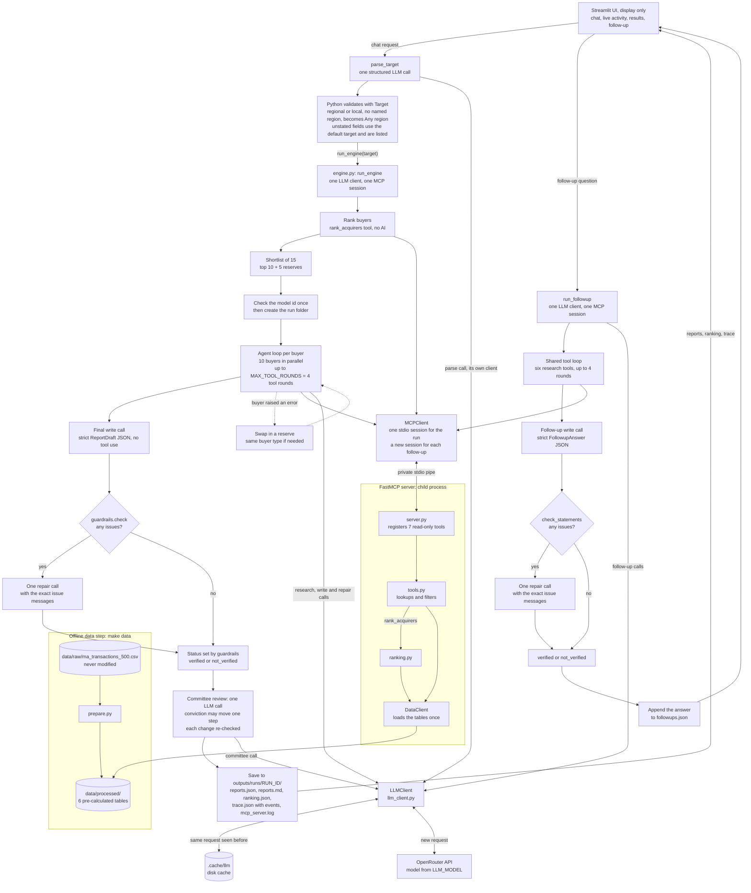
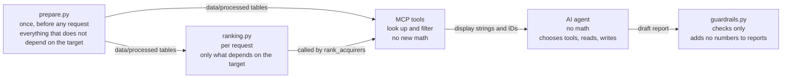

# Architecture

## 1. Overview

The engine takes a target company profile (by default a private, regional Healthcare Services business worth about $200M with strong EBITDA margins) and returns the 10 buyers most likely to acquire it, each with a one-page, source-cited report. The work is split so that the AI never does arithmetic. Python prepares every statistic ahead of time from the 500-row transaction CSV (`prepare.py`) and scores buyers for the given target (`ranking.py`). A FastMCP server exposes the data as read-only tools. For each buyer, an AI agent chooses which tools to call, reads the results and writes the report. Python then checks every statement against the exact tool results that agent received (`guardrails.py`). A report that still fails after one repair attempt is kept and clearly marked "Not verified". A Streamlit app is display only: chat request, parsed target, `run_engine` with live activity, results dashboard, then follow-up chat.

## 2. Request flow (as built)



A chat request is handled by `parse_target` before any run. That is one structured LLM call (`prompts/parse_request.md`). The model only extracts what the sentence states. Python then checks the fields with `Target`. If the sentence says "regional" or "local" and names no region, geography is set to "Any region", including when the model returns "Multi-Regional". A region named in the sentence is used instead. Fields the sentence does not state come from the default target, in field order: sector Healthcare Services, `ev_mm` 200, ownership Private, geography Any region, `margin_profile` strong. The call returns the names of those filled-in fields. Setting geography to Any region because the sentence said regional or local counts as stated, so that field is not in the list. A value written in billions is turned into millions in Python. A value `Target` does not allow is rejected with a clear error. The sentence is kept as data and is not executed. Parsing uses its own LLM client. It does not open the MCP server and does not create a run folder. The app shows the parsed target, then calls `run_engine`.

The order inside `run_engine` (`src/ma_engine/engine.py`) is: create the LLM client (this fails at once if the API key is missing), start the MCP session, call `rank_acquirers` through MCP, ask OpenRouter once for the model's supported parameters (this fails at once if the model id is wrong), create the run folder, research the buyers, run the committee review, save.

A follow-up question calls `run_followup`. That opens one new LLM client and exactly one MCP session, then uses the same tool loop as buyer research: the six research tools, up to 4 rounds, then one strict `FollowupAnswer`. `check_statements` checks the statements. One repair sends the exact issue messages. The answer is appended to `followups.json`.

## 3. Execution trace and live activity

Every step of a request parse, a run, or a follow-up is one event record. The same records are sent live to `progress` and kept afterwards. A saved run does not rebuild them: read `trace["events"]` from `load_run`. A follow-up keeps its own list, with its own step numbers, on the answer and in `followups.json`. Parsing sends events to `progress` only. It happens before the run, so those events are not in `trace.json`.

Every event has the same keys. A value that does not apply is null.

| Field | Meaning |
|---|---|
| `step` | Increasing number for this run, this follow-up, or this parse |
| `ts` | UTC time, ISO-8601, ending in `Z` |
| `category` | `llm`, `mcp_tool`, `validation`, `calculation`, or `app` |
| `name` | Tool name; an LLM purpose (`research`, `write`, `repair`, `committee`, `parse_request`, `followup`); or `check`, `ranking`, `apply_committee`, `run`, `request`, `mcp_connected`, `substitution`, `buyer_failed`, `save` |
| `acquirer_key` | The buyer, when the step is about one buyer |
| `round` | The tool round, when there is one |
| `status` | `running`, `completed`, or `failed` |
| `duration_ms` | How long the step took, in milliseconds. Null while it is running |
| `input` | For a tool, the arguments object passed to `call_tool`. For an LLM call, only `model`, `message_count`, and `tool_count` |
| `output_summary` | Short counts: rows, source IDs, warnings, issue count, tokens, and similar |
| `output` | Full tool result for a tool call. Issue messages for a check. For an LLM call, the visible assistant text, cut at 300 characters |
| `error` | Error text, if any |
| `attempts` | For an LLM call, a list of `{n, error}` in try order. `error` is null on the try that worked. Null for every other step |
| `tokens_in`, `tokens_out`, `cost_usd` | Numbers on a completed LLM call. A cache hit, or a provider that omits usage, stores 0. Null while the call is running, on a failed call, and on every other step |
| `decision` | One or two factual sentences from what was recorded. Null while the step is running |
| `message` | One line for the CLI |

The categories are `llm` (a model call), `mcp_tool` (a tool call), `validation` (the guardrail check), `calculation` (the ranking summary, and applying the committee's conviction changes), and `app` (parsing the request, starting the run, the MCP connection line, a substitution, a buyer that failed with no reserve left, and the save).

A step is sent twice. The first record has status `running`. The second has the same `step` and status `completed` or `failed`, so that row can be updated in place. `duration_ms` and `decision` are null on the running record.

The agent sends the research rounds, the tool calls, the write, the check, the repair, the request parse, and the follow-up steps. The engine sends the run start, the MCP connection, the `rank_acquirers` call, the ranking summary, the committee application, a substitution, a buyer failure with no reserve, and the save. The committee model call is recorded by the agent, so it is an `llm` event named `committee`. On a follow-up, the tool-picking calls use the name `research` (the same loop as a buyer) and the answer itself uses the name `followup`. The buyer field is empty. The LLM client does not send events. It keeps the list of attempts, and the agent copies that list onto the finished LLM event. The MCP client does not send events either. The agent and the engine record a tool call after `call_tool` returns.

A run sends nothing before its MCP session opens. If that server fails to start, the run's event list stays empty. Parsing a request does not open the server. Its events are only the parse.

A run's events come in this order: `run`, `mcp_connected`, the `rank_acquirers` tool call, the ranking summary, then the buyers. The buyers run at the same time, so their events share one counter and can be mixed together. Each buyer still goes research, any tool calls, then the write, the check, and a repair plus a second check when the first check finds issues. A substitution is recorded when a buyer errors and a reserve takes the place. `buyer_failed` is recorded only when no reserve is left. After the buyers come the committee call, `apply_committee`, and `save`.

`trace.json` stores the list on `events`. A tool event's `input` is the arguments exactly as sent, and its `output` is the full result. An LLM event's `output` is the visible assistant text, cut at 300 characters. Reasoning text from the model is never stored. The check event's `output` is the issue messages.

`decision` is built only from recorded actions. It never includes the model's reasoning. Examples are "Requested 2 tools: get_acquirer_profile, get_valuation_comps", "No further tool calls; moved to writing", "Guardrails found 3 issues; sent one repair", and "Requested 2 tools: get_acquirer_profile, get_valuation_comps. Stopped at round limit".

Secrets are not recorded. An LLM event's `input` is only the model, the message count, and the tool count. If an error string contains the API key, the key is replaced with `***` before it is stored. Headers and environment values are not stored. Two tests prove this. `test_events_match_execution_and_ranking_is_saved` sets a key and checks that the saved `trace.json` does not contain it. `test_retry_then_success_is_attempt_two` puts the key inside a connection error and checks that the events do not contain the key or the word Authorization, and that the failed attempt's error contains `***`.

The LLM client does its own retry. The OpenAI library's retry is off (`max_retries=0`). This client retries connection errors, timeouts, and HTTP 408, 409, 429, and 5xx. `MAX_RETRIES` is 2, which is the number of tries, not extra tries after the first. The wait after the first failed try is 0.2 seconds. That wait doubles for a later try, which the limit of two tries does not reach. A 400 or a 401 is raised at once. Each try is stored in `attempts`.

`trace["totals"]`, and the same keys on a follow-up answer, are `wall_time_s`, `llm_calls`, `mcp_tool_calls`, `tokens_in`, `tokens_out`, `cost_usd`, and `cache_hits`. The tool-call count is the number of tool events that have finished, completed or failed, including `rank_acquirers`. The LLM call count includes cache hits, which are also counted on their own. The CLI prints each event's `message`.

## 4. Where calculations happen



Ranking cannot be pre-calculated because it depends on the target's sector, size and region. It stays in tested Python, so the rule "the AI never calculates" still holds for any target profile.

## 5. Components

**Configuration** (`src/ma_engine/config.py`). The only file that reads environment variables. `.env` holds exactly two: `OPENROUTER_API_KEY` and `LLM_MODEL`. It also holds shared settings: file paths, `MAX_TOOL_ROUNDS = 4`, `MAX_PARALLEL_BUYERS = 10`, `MAX_REPAIR_ATTEMPTS = 1`, `SHORTLIST_SIZE = 15`, `REPORT_COUNT = 10`, `REASONING_EFFORT = "low"`, request timeout and retries, and the default target. Importing it never fails when the key is missing. `require_api_key()` raises a clear error only when the LLM client is actually created. It has no feature toggles.

**Data step** (`src/ma_engine/prepare.py`, run by `make data`). Reads the raw CSV as text and checks it: expected columns, unique and non-empty `transaction_id` (the pipeline stops if not), valid numbers and categories. It writes six files to `data/processed/`: `transactions.csv` (the 24 original columns, unchanged, plus derived fields such as `acquirer_key`, `is_closed`, `size_band`, `margin_vs_sector`, `is_regional`), `acquirer_profiles.json` (one profile per buyer), `valuation_comps.csv` (closed-deal multiples by sector, scope and size band), `sector_stats.csv`, `sector_similarity.csv` (hand-written sector closeness, adjacent at 0.6 or above) and `data_quality.json`. Every number gets a ready-to-quote display string (`$185.0M`, `13.2x`, `24.1%`), rounded half-up once from the true value. It never changes the raw file and never depends on the target.

**Data client** (`src/ma_engine/clients/data_client.py`). Loads the six processed files once (`get_client()` is cached) and offers small lookups and row filters. If a file is missing it says "Run `make data` first." It calculates no statistics. For single deal rows it builds `{"value", "display"}` pairs with the same formatting helpers as `prepare.py`, so the project has one formatter. Stated multiples and margins are quoted as given and never re-derived, because the data step found that these columns often disagree with revenue and EBITDA.

**MCP server and tools** (`src/ma_engine/mcp_server/server.py`, `tools.py`). `tools.py` holds plain Python functions that can be tested without MCP. `server.py` only registers them with FastMCP, marks them read-only (`readOnlyHint`), and loads the data once at start. Every tool returns `{"data", "source_ids", "warnings"}`. Unknown argument values are rejected with the list of allowed values, `limit` is capped at 25, and an empty result is a normal answer with a warning. Tools never calculate new statistics. The seven tools are:
- `get_dataset_overview()`: whole-dataset counts and the allowed values for every other tool's arguments. Its `source_ids` is empty, so citations come from the other tools.
- `get_sector_overview(sector)`: pre-calculated sector statistics and how close every other sector is. Closeness sits in an `assumption` field, which is judgment, not data.
- `get_acquirer_profile(acquirer_key)`: one buyer's pre-calculated profile (counts, sectors, deal types, deal sizes, median multiples paid, financing, bidders, days to close, years), each number with its IDs.
- `get_acquirer_deals(acquirer_key, sectors, closed_only=True, limit=10)`: one buyer's deal rows, newest first, with each deal's outcome.
- `get_valuation_comps(sector, scope, size_band)`: 25th percentile, median and 75th percentile of EV/EBITDA and EV/Revenue from closed deals, with sample sizes.
- `search_deals(sectors, size_band, outcomes, acquirer_type, deal_types, geography, limit=10)`: deal rows across all buyers that match every filter. Filtering only, no totals.
- `rank_acquirers(sector, ev_mm, ownership, geography, margin_profile, limit=15, excluded_keys)`: the ranked shortlist from `ranking.py`. The engine calls it. It is hidden from the research agent (`agent.ENGINE_ONLY_TOOLS`), because its output covers every buyer and would widen the IDs a buyer's report could cite.

**Ranking** (`src/ma_engine/ranking.py`). Python only. The candidate pool is every buyer with at least one closed deal in the target sector or an adjacent sector. Deals that did not close are listed as `weak_signal_ids` and add nothing to the score. Six signals, each between 0 and 1, use the buyer's relevant closed deals. The weights are in `WEIGHTS`:

| Signal | Weight | What it measures |
|---|---|---|
| `sector_fit` | 0.25 | Average sector closeness of the deals |
| `size_fit` | 0.20 | Per deal `1 - abs(ln(deal size / target EV)) / ln(10)`, floored at 0 |
| `repeat_activity` | 0.20 | `weighted / (weighted + 3)`, where a target-sector deal counts 1 and an adjacent deal counts its closeness |
| `profile_fit` | 0.15 | Shares of deals matching the target's ownership, region (regional or the named region) and above-median margin (the margin part is dropped when `margin_profile` is `"any"`) |
| `recency` | 0.10 | A deal's weight halves every 3 years, counted back from the dataset's last year |
| `rationale_fit` | 0.10 | Share of deals tagged Platform Build, Scale or Market Share (plus Margin Improvement when `margin_profile` is `"any"`) |

Every per-deal average except `repeat_activity` is blended with 2 neutral pseudo-deals at 0.5 (`PRIOR_DEALS`, `PRIOR_VALUE`), so a buyer with one perfect deal does not outrank a long, mostly fitting record. The starting conviction uses bars taken from this target's own candidate scores. High means a score at or above the 90th percentile and at least 2 relevant closed deals within 2x of the target EV. Medium means a score at or above the median and the same 2-deal condition. Everything else is Low. The buyer-type coverage rule (`MIN_PER_TYPE = 3`) makes sure the top 10 holds at least 3 Financial Sponsors and 3 Strategics when the pool has them. The direct-deal guard promotes missing-type buyers that have a closed deal in the target sector first. Buyers without one are promoted only if none are left, and then a warning names them. Promoted buyers displace the lowest-scoring buyers of the other type, and both sides get a `selection_note`. The 5 reserve places (ranks 11–15) hold at least one buyer of each type when the pool has one, so a failed buyer can be replaced by one of the same type. Each buyer has `rank` (final place) and `score_rank` (place by score alone). Every explanation is a template filled with display strings. Ranking never uses the AI and never names a buyer in code.

**LLM client** (`src/ma_engine/clients/llm_client.py`). One client for a run, for a request parse, or for a follow-up: the `openai` library's `AsyncOpenAI` pointed at OpenRouter. The library's own retry is off (`max_retries=0`). This client retries temporary failures itself: connection errors, timeouts, and HTTP 408, 409, 429, and 5xx, up to `MAX_RETRIES` (2) tries. The wait after the first failed try is 0.2 seconds. That wait doubles for a later try, which the limit of two tries does not reach. A 400 or a 401 is raised at once. Each try is returned on the result as `attempts` (`error` is null on the try that worked). If every try fails, the same list is on the exception. The API key in an error is replaced with `***`. Headers and environment values are not included. Every response is stored in `.cache/llm/<sha256>.json`. The cache key covers the model, messages, tools, tool choice, schema and sampling settings. A cache hit makes no network call and costs 0. Outputs that fail to parse are not cached. With `use_cache=False` the cache is not read, but the fresh answer is still stored. Supported-parameter filtering works like this: the client reads the model's supported parameters from OpenRouter's model list once. It sends `temperature`, `seed`, `reasoning_effort` and `max_tokens` only if the model lists them, and records the rest as `dropped_parameters`. A missing or unknown model id raises `LLMConfigError`. Structured output uses `response_format` with `json_schema` and `strict: true`, plus `provider.require_parameters: true`, so OpenRouter routes only to providers that support every parameter sent. `strict_schema()` moves the keywords that strict mode rejects (such as `maxItems`) into field descriptions; Pydantic still enforces them after parsing. The client only talks to the model. It never checks report content.

**MCP client** (`src/ma_engine/clients/mcp_client.py`). Starts the server as a child process with the same Python interpreter, from the repo root, exactly as `make mcp` does (`python -m ma_engine.mcp_server.server`). It opens one session for the whole run, lists the tools once and converts them to the chat tool format. Every buyer shares this session, and parallel calls on it work. Each call has a 30-second timeout. Tool errors come back as `{"error": message}`, so the model sees them as normal tool results. The server's stderr goes to the run's `mcp_server.log`. A follow-up opens its own session. That session's log is removed when the question finishes, and is not added to the run folder.

**Agent loop** (`src/ma_engine/agent.py`, prompts in `src/ma_engine/prompts/`). A hand-written tool loop, shared by buyer research and follow-up answers. For a buyer, the system prompt is `research_writer.md`, filled with the ranking's target block and this buyer's ranking entry (and, for promoted or substituted buyers, an instruction to say why they are on the list). Each round is one LLM call with the six research tools. All tool calls the model asks for in a round run in parallel. The loop stops when the model replies without tool calls, or after `MAX_TOOL_ROUNDS` (4) rounds. Within one loop, an identical repeated call (same tool, same arguments) is answered from a small cache with a note telling the model it already has this result. Bad arguments, unknown tools and `rank_acquirers` all return an error message to the model instead of crashing. Then comes one final write call over the whole conversation. Tools are still sent (OpenRouter requires them in a tool conversation) but with `tool_choice="none"`, and `ReportDraft` is the strict output schema. The buyer's evidence is the target block, its ranking entry and every successful tool result. If `guardrails.check` finds issues, one repair call sends the exact messages (`repair.md`). If there is still no valid JSON after repair, the buyer fails with `ReportError` and the engine treats it as a buyer error. Otherwise the report keeps whatever status the guardrails give it. The agent never calculates and never writes the final Markdown.

`answer_followup` uses that same loop. Its prompt (`followup.md`) holds the target block, the ranking entries of the reported buyers, and a short summary of each report: rank, buyer, type, conviction, status, and the first two strategic-fit statements. It may call the six research tools only. The write call uses `FollowupAnswer`, a list of statements, and `check_statements` is the check. One repair sends the exact issues. If the answer still fails, or never parses, it comes back `not_verified` with those issues. Python renders the Markdown, including the `[MA-…]` tags. The follow-up uses its own step counter.

`parse_request` is separate from the tool loop. One structured call (`parse_request.md`, schema `RequestFields`) extracts only the fields the sentence states. The allowed values in the prompt come from the data: sectors, ownerships, and regions, plus Any region. Python then applies the regional rule, converts a billion figure into millions, fills the gaps from the default target, and validates with `Target`. Events for this call go to `progress` only.

**Guardrails** (`src/ma_engine/guardrails.py`). Python only. `build_evidence` reads the buyer's ranking entry and tool results. A raw `value` that has a `display` string beside it is skipped, so only the display string can be quoted. It also records a `Source` for each piece of evidence. A deal row supports only its own ID. A statistic supports its `source_ids`. Each source is marked as "buyer", "comp", "target" (the target block, quotable without a citation) or "assumption" (supports no ID). `check(report, evidence)` returns fix-oriented messages, and an empty list means the report passed. The current checks are:
- Structure: identity and starting level match the ranking, the four main sections are not empty, at least 2 distinct risk flags, and conviction at most one step from the starting level.
- Citations: every `fact`, `interpretation` and the conviction reason cites at least one ID. Each ID must be well-formed, exist in the dataset and appear in this buyer's evidence. An ID written in the text must also be in `source_ids`.
- Buyer versus comps: overview and fit statements must cite at least one of this buyer's own deals, and precedent statements may cite only its own deals.
- Numbers and claim-to-source binding: every number must appear in the evidence exactly as displayed (with a "Did you mean" hint when it doesn't). It must also come from a source whose IDs overlap the statement's cited IDs. Overview, fit and precedent sections may not use comp figures. A year passes if it is the year of a cited deal. Assumption numbers (sector closeness) can never be cited as facts.
- Sample sizes: each `n=<count>` must be the n stored beside a number quoted in the same statement.
- Outcome words and deal types: "Withdrawn", "Pending", "Terminated", "Rumored" and dataset deal types (for example "Platform Investment") must match a cited deal.
- Completion wording: a statement citing a deal that did not close may not use acquired, acquisition of, completed, closed, bought or purchased.
- Valuation: valuation statements cite closed deals only and state `n=`.
- Company names: every name must be in the evidence and must be the target or buyer of a cited deal.
- Unknowns: `unknown` statements contain no numbers and no IDs.

`check_statements` checks a follow-up answer, which is a list of statements rather than a full report. It runs the statement checks: citations, numbers and claim-to-source binding, sample sizes, outcomes, deal types, company names, completion wording, and unknowns. An empty answer fails. It does not run the report checks: identity and starting level, the four sections, the risk flags, the one-step conviction limit, or the section rules. Those section rules are: overview and fit must cite this buyer's own deals, precedents may cite only that buyer's deals, overview, fit and precedent may not use comp figures, and a valuation statement must cite closed deals and state `n=`. A follow-up statement may quote a number from the target block, a ranking entry, or this answer's tool results. The number still has to be the display string, and, except for the target block, it still has to belong to a cited ID. Evidence is the target block, the ranking entries of the reported buyers, and the tool results from this answer. One repair sends the exact issues. If it still fails, the answer is kept and marked "Not verified".

`apply_check` sets `verified` or `not_verified`. Python, not the AI, renders the Markdown and adds the `[MA-…]` tags from `source_ids`, so the shown citations are exactly the checked ones. `length_warnings` (over 60 words per statement, over 650 per report) are warnings only. `quality_metrics` and `make check` produce a run-level pass/fail. The guardrails never edit or hide a report.

**Committee review** (`engine._committee`, prompt `committee.md`). One structured LLM call (`CommitteeReview`) over short summaries of all reports. Each summary holds the buyer's identity, starting level and reason, the writer's proposed level and reason, its strategic-fit statements and up to 6 fact statements. The committee returns one conviction decision per buyer and any pairs of buyers whose fit arguments are the same. A decision is applied only if the changed conviction passes every `conviction:` check for that buyer: still at most one step from Python's starting level, cites valid IDs, uses only that buyer's numbers. The report's status is then re-set by `apply_check`. Unknown or duplicate keys are rejected and recorded. If the output does not parse, the writers' levels are kept and the reason is recorded. The committee never writes report text other than the conviction reason.

**Engine** (`src/ma_engine/engine.py`). `run_engine(target, use_cache=True, excluded_keys=(), progress=None)` runs the whole pipeline and sends live event records to `progress`. It returns the run id, the folder, the target, the ranking, the reports, and the trace. `trace["events"]` is the activity list. `trace["totals"]` holds the run totals. The top 10 buyers are researched at the same time (`asyncio.gather` under `Semaphore(MAX_PARALLEL_BUYERS)`), all sharing one LLM client and one MCP session. Substitution: if a buyer's research raises an ordinary error, `pick_reserve` chooses the replacement. It is the first reserve of the same buyer type if losing the failed buyer would leave fewer than 3 of that type, and otherwise the next reserve. The replacement's `selection_note` says "Replaced … after an error". The error and the failed buyer's partial trace are kept. Reports are then put back in shortlist order and renumbered 1..N, and `score_rank` is unchanged. Run-level errors are errors that would hit every buyer the same way: `LLMConfigError`, authentication, permission and rate-limit errors (a rate-limit error that reaches the engine has already been retried). These cancel all buyer tasks and save nothing. Run headless (`python -m ma_engine.engine`), the error is printed as one line and the process exits with code 1. The run folder is created only after ranking and the model check succeed. Until then the server log waits in a hidden file in `outputs/runs/`, so a run that stops early leaves no folder. Folder names are timestamps (`20261031-173000`), with `-2`, `-3` added if the name is taken. A run-level error during research leaves a folder holding only `mcp_server.log`, kept because it may explain the failure. The engine calculates nothing and calls no tool other than `rank_acquirers` itself.

`parse_target(text)` creates one LLM client and calls `parse_request`. It returns the target and the list of field names filled from the default. It does not open MCP and does not start a run. The app shows that target, then calls `run_engine`. `run_followup(question, run)` creates one LLM client and exactly one MCP session, calls `answer_followup`, and appends the answer to `followups.json` (a list) in the run folder. `load_run(run_dir)` returns the same keys as `run_engine`. `ranking` is None when `ranking.json` is missing, and `trace` is an empty object when `trace.json` is missing. Reports come from `guardrails.load_reports`. The saved activity is `trace["events"]`. It is not rebuilt. A follow-up needs that ranking file. Without it, the question stops with a clear error.

**Outputs** (`outputs/runs/<run_id>/`, not committed):
- `reports.json`: `{"run_id", "target", "reports": [BuyerReport, ...]}`, each report with draft, status and issues.
- `reports.md`: a summary table followed by every rendered report.
- `ranking.json`: the `rank_acquirers` data, including the target block, the shortlist, and the score fields. Written with the run, so a saved run can show the same scores and a follow-up can be checked.
- `trace.json`: model, wall time, ranking, research and committee times, per-buyer tool calls (round, arguments, duration, status, repeated) and LLM calls (tokens, cost, cache hit, dropped parameters), first-check issues, repairs, errors with partial traces, substitutions, the committee record and quality metrics. It also holds `events` (the activity list, including the finished save) and `totals` (`wall_time_s`, `llm_calls`, `mcp_tool_calls`, `tokens_in`, `tokens_out`, `cost_usd`, `cache_hits`). The per-buyer lists remain under `buyers`.
- `followups.json`: a list of follow-up answers, appended by `run_followup` when a question is asked. It is not written by the original save. Each item has the question, statements, status, issues, markdown, that answer's `events`, and `totals`.
- `mcp_server.log`: the server's stderr for the run. A follow-up does not append to this file.

`outputs/sample/` is where one committed example run goes, for reviewers without an API key.

**Streamlit UI** (`src/ma_engine/app.py`, started by `make run`). Display only. The path on screen is chat request, parsed target, `run_engine` with live activity, results dashboard, follow-up chat.

**Docker** (`Dockerfile`, `.dockerignore`). One container, one stage, on `ghcr.io/astral-sh/uv:0.6.17-python3.12-bookworm-slim`. Dependencies come from `uv.lock` (`uv sync --frozen --no-dev`), and the processed tables are rebuilt from the raw CSV during the build. Streamlit is the main process. The MCP server is not a separate container or service: the engine starts it as a child process inside the same container and talks to it over a private stdio pipe. Only port 8501 (Streamlit) is exposed, with a health check on `/_stcore/health`. `tini` is PID 1, so `docker stop` reaches Streamlit and the MCP child process is cleaned up. The app runs as the non-root user `app` (uid 1000), which can write only `outputs/` and `.cache/`. `.dockerignore` is an allow-list (`pyproject.toml`, `uv.lock`, `.python-version`, `src/`, `data/raw/`), so `.env` never enters the image. The key is passed at run time with `--env-file .env`. The LLM cache lives inside the container, so it is lost when the container is removed.

## 6. How one number travels from the CSV to a checked statement

A real example: Blackstone's 2021 Healthcare Services deal for Evergreen Care Solutions.

**Step 1: raw CSV** (`data/raw/ma_transactions_500.csv`), as text:

```text
transaction_id=MA-2021-0195  acquirer=Blackstone  target_company=Evergreen Care Solutions
sector=Healthcare Services  deal_year=2021  deal_type=Bolt-on Acquisition  outcome=Closed
deal_size_mm=299.0  ev_ebitda_multiple=14.6  ev_revenue_multiple=2.45  ebitda_margin_pct=12.9
```

**Step 2: processed table** (`data/processed/transactions.csv`, written by `prepare.py`). The 24 original columns are unchanged. Derived fields are added: `acquirer_key=blackstone`, `is_closed=True`, `size_band=$100M–$400M`, `margin_vs_sector=below`, `is_regional=True`.

**Step 3: tool result** (`get_acquirer_deals("blackstone", sectors=["Healthcare Services"])`). Each number is a value with a ready-to-quote display string:

```json
{"transaction_id": "MA-2021-0195", "target_company": "Evergreen Care Solutions",
 "deal_year": 2021, "deal_type": "Bolt-on Acquisition", "outcome": "Closed",
 "deal_size_mm": {"value": 299.0, "display": "$299.0M"},
 "ev_ebitda_multiple": {"value": 14.6, "display": "14.6x"},
 "ev_revenue_multiple": {"value": 2.45, "display": "2.5x"}}
```

**Step 4: report statement** (written by the agent in `precedent_activity`, labelled `fact`, `source_ids: ["MA-2021-0195"]`). Python renders it with the citation tag:

> In 2021, Blackstone acquired Evergreen Care Solutions, a Healthcare Services Bolt-on Acquisition, for $299.0M at 14.6x EV/EBITDA and 2.5x EV/Revenue. [MA-2021-0195]

**Step 5: guardrails binding check.** These are real results from `guardrails` on this evidence:
- As written: no issues.
- With the raw value `2.45x` instead of `2.5x`: `number "2.45x" does not appear in the tool results for this buyer.` The raw value has a display string beside it, so only `2.5x` counts as evidence.
- The same sentence citing Blackstone's other 2021 deal, `MA-2021-0407`, instead: five issues, including `"$299.0M" belongs to MA-2021-0195, but the statement cites MA-2021-0407. Cite MA-2021-0195 or use the figures for MA-2021-0407 ($341.7M, EV/EBITDA 10.0x, EV/Revenue 1.5x, 2021).` The same message is given for `14.6x` and `2.5x`, and separate messages flag "Bolt-on Acquisition" (MA-2021-0407 is a SPAC Merger) and "Evergreen Care Solutions" (the target of MA-2021-0195, not of MA-2021-0407).

So every number in a verified report can be traced to a display string in a tool result, and that display string can be traced to the deal it belongs to.

## 7. Connecting an outside MCP client

The same server the app uses can be used by any MCP client (Claude Desktop, Cursor, another agent). It needs no API key, because it only reads the processed data. Run `make setup` and `make data` first.

- Locally: `make mcp` (runs `uv run python -m ma_engine.mcp_server.server`). This is a stdio server: it waits for a client on its input and output. You would normally let the client start it rather than run it by hand.
- From the Docker image: `docker run -i --rm ma-engine python -m ma_engine.mcp_server.server`. The `-i` flag keeps the input pipe open. Data is already built into the image.

Example client config (`claude_desktop_config.json` for Claude Desktop, or `.cursor/mcp.json` for Cursor). Replace the path with where the repo lives:

```json
{
  "mcpServers": {
    "ma-engine": {
      "command": "uv",
      "args": ["--directory", "/path/to/wb_draft", "run", "python", "-m", "ma_engine.mcp_server.server"]
    }
  }
}
```

`--directory` makes uv change into the repo before running, so it finds the project and its `.venv`. If the client cannot find `uv`, use its full path (from `which uv`), because desktop apps often do not see your shell's `PATH`. To use the Docker image instead, set `"command": "docker"` and `"args": ["run", "-i", "--rm", "ma-engine", "python", "-m", "ma_engine.mcp_server.server"]`.

The client will see all seven tools, including `rank_acquirers`, with their docstrings as instructions. The server's own instructions tell any client to quote display strings exactly, cite IDs from `source_ids`, and never describe deals that did not close as completed.

## 8. Design decisions

- **FastMCP instead of calling the Python functions directly.** The tools are a separate, read-only layer with one result shape. The same server serves the app's agent and any outside MCP client, and nothing outside it can widen what the agent can reach. The tool logic stays as plain functions in `tools.py`, so tests call them directly, plus one in-memory FastMCP test.
- **A hand-written loop instead of an agent framework.** The tool loop is one function in `agent.py`, shared by buyer research and follow-up answers. Every step is visible and testable: the round limit, parallel tool calls, the repeated-call cache, the final write call with a strict schema, and the single repair. Frameworks would add hidden retries, prompts and state that are harder to control under the "AI never calculates" and citation rules.
- **stdio transport.** The server runs as a child process of the app over a private pipe. It opens no network port, needs no extra service, and starts and stops with the run, so the app still starts with one command and the container exposes only port 8501. FastMCP's stdio transport passes only a few basic variables (such as `HOME` and `PATH`) to the server, so the API key does not reach it. HTTP transport is the natural next step if the tools ever need to be shared across machines.
- **A disk cache for repeatability.** OpenRouter's model list (checked 2026-10-31, recorded in `plans/PROGRESS.md`) shows that `anthropic/claude-sonnet-5.5` does not accept `temperature` or `seed`. Because the client asks OpenRouter to route only to providers that support every parameter sent (`require_parameters`), sending them would leave no provider. So they are dropped for this model (recorded in the trace as `dropped_parameters`), and `reasoning_effort = "low"` is sent because the model supports it. Repeat runs of the same target are identical only because of the response cache in `.cache/llm/`: the second run answers every call from disk with no network calls and no cost. A run with `use_cache=False` skips reading the cache, asks the model again and stores the new answers.
